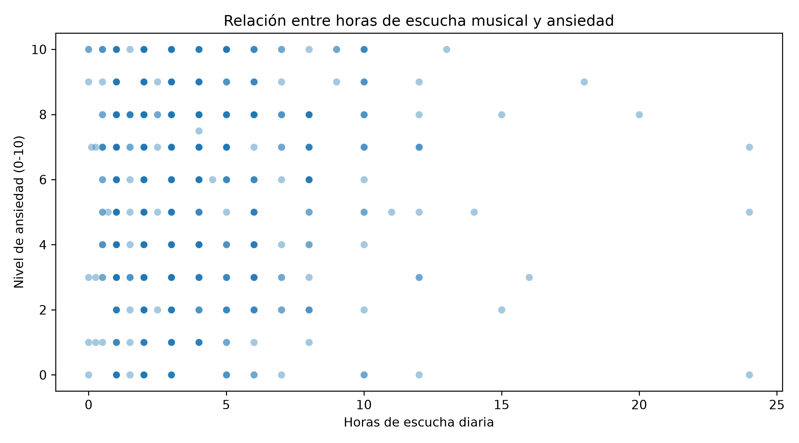
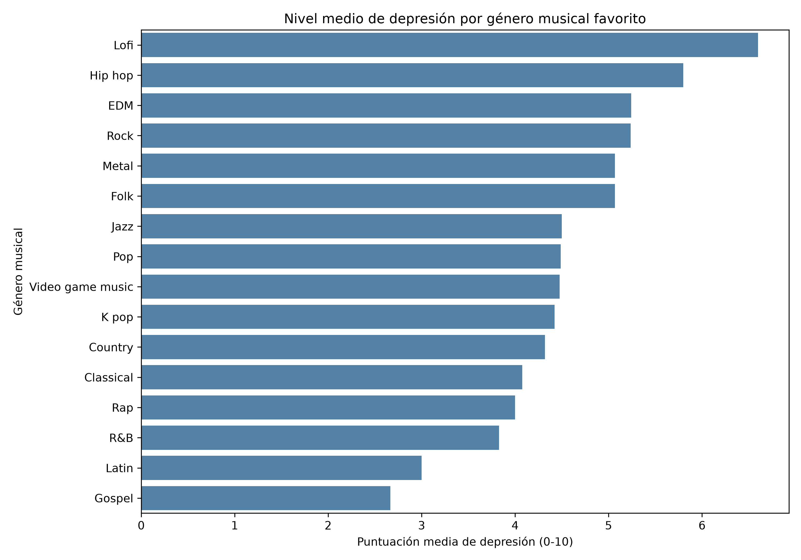
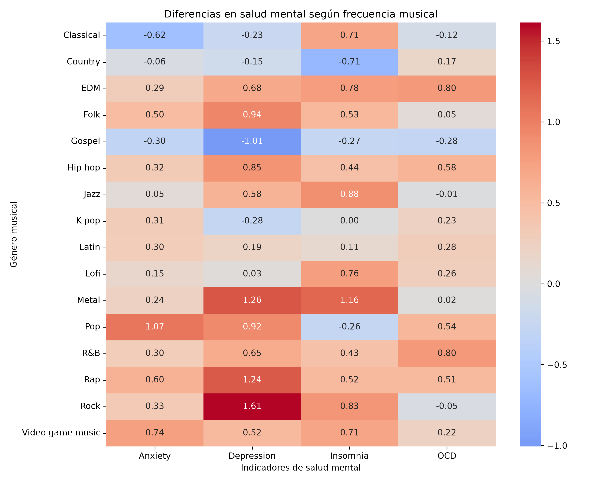
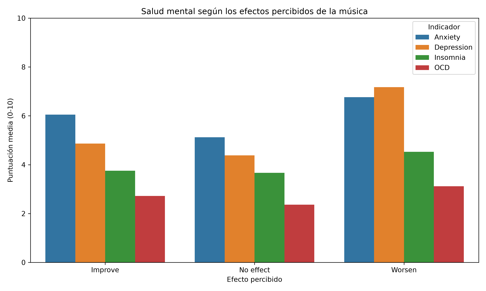

# Música y salud mental: análisis exploratorio de datos

## Descripción del proyecto

Este proyecto consiste en un análisis exploratorio de datos (EDA) sobre la relación entre los hábitos de escucha musical y diferentes indicadores de salud mental.

Se ha utilizado el dataset **Music & Mental Health Survey (MxMH)**, que recoge información sobre las preferencias musicales, los hábitos de escucha y las puntuaciones autodeclaradas de ansiedad, depresión, insomnio y trastorno obsesivo-compulsivo (TOC).

El objetivo es aplicar técnicas de exploración, limpieza, transformación, análisis descriptivo y visualización de datos utilizando Python.

## Objetivos e hipótesis

El análisis se organiza en torno a cuatro preguntas:

**H1. Horas de escucha y ansiedad**

¿Existe una relación visual entre las horas diarias de escucha musical y los niveles de ansiedad?

**H2. Género favorito y depresión**

¿Se observan diferencias en los niveles medios de depresión según el género musical favorito?

**H3. Frecuencia de escucha y salud mental**

¿Cómo varían los indicadores de ansiedad, depresión, insomnio y TOC según la frecuencia de escucha de distintos géneros musicales?

**H4. Efectos percibidos de la música**

¿Existen diferencias en los indicadores de salud mental según los efectos que los participantes atribuyen a la música?

## Dataset

**Fuente:** Music & Mental Health Survey (MxMH), disponible en Kaggle.

El conjunto de datos original contiene:

- 736 registros.
- 33 columnas.
- Variables demográficas, hábitos musicales e indicadores de salud mental.

Entre las variables principales se encuentran `Age`, `Hours per day`, `Fav genre`, `Music effects`, `Anxiety`, `Depression`, `Insomnia` y `OCD`.

Los indicadores de salud mental son puntuaciones autodeclaradas entre 0 y 10, no diagnósticos clínicos.

### Preparación de los datos

Durante la limpieza se realizaron las siguientes operaciones:

- Exploración de la estructura del dataset y sus valores nulos.
- Revisión de posibles duplicados y valores extremos.
- Eliminación de la columna `BPM`, por sus problemas de calidad y su falta de relevancia para las hipótesis.
- Transformación de las frecuencias de escucha musical en valores numéricos ordenados del 0 al 3.
- Tratamiento de los valores nulos según las necesidades de cada análisis.

El dataset preparado contiene **736 registros y 32 columnas**.

Se conserva una copia del dataset preparado como resultado intermedio. Sin embargo, el programa principal carga el archivo original y aplica automáticamente las transformaciones necesarias.

## Metodología

El proyecto se ha desarrollado en cuatro fases:

1. **Exploración inicial:** revisión de las variables, tipos de datos, distribuciones y valores nulos.
2. **Limpieza y preparación:** transformación de variables y preparación del dataset para el análisis.
3. **Análisis descriptivo:** agrupaciones, cálculos de medias y comparaciones entre grupos.
4. **Visualización:** representación de los resultados mediante gráficos de dispersión, barras y mapas de calor.

Los análisis se han desarrollado inicialmente en Jupyter Notebook y posteriormente se han organizado en funciones reutilizables de Python.

## Principales resultados

### H1. Horas de escucha y ansiedad

El gráfico de dispersión no muestra una tendencia visual clara entre las horas diarias de escucha musical y las puntuaciones de ansiedad.



### H2. Género favorito y depresión

Se observan diferencias en las puntuaciones medias de depresión según el género musical favorito.

Lofi y Hip hop presentan algunas de las medias más elevadas, aunque es necesario considerar el tamaño de cada grupo.



### H3. Frecuencia de escucha y salud mental

Al comparar quienes nunca escuchan determinados géneros con quienes los escuchan muy frecuentemente, se observan diferencias descriptivas en los indicadores psicológicos.

Destacan algunas diferencias positivas en depresión para Rock, Metal y Rap, aunque no existe un patrón uniforme.



### H4. Efectos percibidos de la música

Los participantes que consideran que la música empeora su salud mental presentan las puntuaciones medias más elevadas en los cuatro indicadores analizados.

No obstante, este grupo contiene únicamente 17 participantes, por lo que los resultados deben interpretarse con precaución.



## Conclusiones

El análisis ha permitido identificar diferencias descriptivas entre determinados hábitos musicales y los indicadores de salud mental autodeclarados.

Los resultados sugieren que la relación entre la música y el bienestar psicológico es compleja y que no puede explicarse únicamente por el tiempo de escucha o el género musical favorito.

Las diferencias observadas no permiten establecer relaciones causales.

Además, la naturaleza autodeclarada de los datos, la composición de la muestra y el tamaño reducido de algunos grupos limitan la generalización de los resultados.

## Estructura del proyecto

```text
Musica_y_subconsciente/
│
├── src/
│   ├── codigo/
│   │   ├── graficos/
│   │   │   ├── H1_horas_ansiedad.png
│   │   │   ├── H2_genero_depresion.png
│   │   │   ├── H3_frecuencia_salud_mental.png
│   │   │   └── H4_efectos_percibidos.png
│   │   ├── funciones.py
│   │   └── main.py
│   │
│   ├── data/
│   │   ├── mxmh_survey_results.csv
│   │   └── mxmh_preparado02.csv
│   │
│   ├── notebooks/
│   │   ├── 01_Exploracion_inicial.ipynb
│   │   ├── 02_limpieza_preparacion.ipynb
│   │   └── 03_Análisis_estadistico.ipynb
│   │
│   └── memoria.ipynb
│
└── README.md
```

## Tecnologías utilizadas

- Python
- Pandas
- NumPy
- Matplotlib
- Seaborn
- Jupyter Notebook
- Visual Studio Code
- Git y GitHub


## Documentación

El archivo `src/memoria.ipynb` contiene la explicación del proyecto, la metodología, los resultados y las conclusiones.

Los notebooks de `src/notebooks/` documentan las diferentes fases del proceso de análisis.

## Fuente de los datos

Music & Mental Health Survey (MxMH), Kaggle.

https://www.kaggle.com/datasets/catherinerasgaitis/mxmh-survey-results